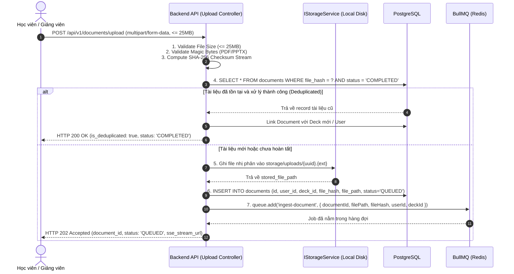

# BÁO CÁO THIẾT KẾ KỸ THUẬT (BRAINSTORM & TECHNICAL DESIGN REPORT)
## UC-03.1: API Tiếp Nhận & Hàng Đợi Upload Tài Liệu (PDF/PPTX $\le$ 25MB)

- **Phân hệ**: Backend AI Pipeline & Tài liệu (Thành viên 2)
- **Use Case liên quan**: UC-03.1 (Upload & Queue), UC-03.2 (SSE Progress), NF-01 (BullMQ Ingestion Worker)
- **Thời gian lập**: 2026-11-08
- **Trạng thái**: Agreed / Ready for Planning

---

## 1. Problem-First Inversion (Phân tích Chiều sâu Vấn đề)

### 1.1. Chẩn đoán Nhảy vội vào Giải pháp (Solution-Jumping Diagnosis)
- **Đề bài ban đầu**: "Viết API upload nhận file PDF/PPTX $\le$ 25MB rồi tống vào BullMQ."
- **Nỗi đau ngầm ẩn bên dưới**:
  - Người dùng không muốn chờ hàng phút trên màn hình trình duyệt khi bóc tách một tài liệu học tập dài 50-100 trang.
  - Server có nguy cơ sập, cạn kiệt RAM hoặc tắc nghẽn I/O nếu nhận nhiều file 25MB cùng lúc.
  - Rủi ro tốn kém chi phí token Gemini API và thời gian vô ích nếu sinh viên upload lại cùng một cuốn sách/slide mà bạn học khác đã từng upload.

### 1.2. Vấn đề Cốt lõi (Underlying Problem)
Xây dựng một cơ chế tiếp nhận tài liệu học tập bất đồng bộ an toàn, tin cậy, không làm nghẽn Event Loop của backend, quản lý vòng đời tệp $\le 25\text{MB}$ độc lập với vòng đời request HTTP, và tối ưu hóa chi phí xử lý AI thông qua cơ chế nhận diện trùng lặp nội dung.

### 1.3. Thách thức Giả định & Đánh giá Rủi ro (Assumption Challenges)
1. **Giả định 1: Đẩy dữ liệu file vào payload của BullMQ Job.**
   - *Rủi ro nếu sai*: Redis cạn RAM, nghẽn I/O network của Redis cluster, sập hệ thống hàng đợi.
   - *Khắc phục*: Redis/BullMQ **chỉ lưu metadata và đường dẫn tệp (file path/key)**. Dữ liệu nhị phân lưu ở Storage.
2. **Giả định 2: Kiểm tra đuôi file `.pdf`, `.pptx` ở client/form-data là đủ.**
   - *Rủi ro nếu sai*: Lỗ hổng bảo mật tải tệp thực thi mã độc giả mạo đuôi mở rộng (Remote Code Execution).
   - *Khắc phục*: Xác thực MIME type kết hợp kiểm tra **Magic Bytes (File Signatures)** ở backend trước khi chấp nhận lưu file.
3. **Giả định 3: Mỗi lần upload là một lần xử lý mới.**
   - *Rủi ro nếu sai*: Lãng phí ngân sách gọi Gemini API, tăng thời gian chờ cho người dùng sau.
   - *Khắc phục*: Băm file theo thuật toán **SHA-256** để nhận diện tài liệu đã xử lý thành công trước đó (Deduplication).

---

## 2. Các Phương án Đã Đánh Giá & Quyết định

| Tiêu chí | Phương án A (Được chọn): Multipart $\to$ Local Storage qua Abstraction | Phương án B: Presigned URL $\to$ S3/R2 Cloud Storage | Phương án C: Chunked Streaming (TUS) |
| :--- | :--- | :--- | :--- |
| **Độ phức tạp** | **Thấp (KISS/YAGNI)** | Trung bình | Rất cao |
| **Phụ thuộc bên ngoài** | Không (Chạy 100% offline dev được) | Cần tài khoản Cloud hoặc MinIO Docker | Cần server TUS chuyên dụng |
| **I/O Server** | Backend gánh nhận file 25MB | Zero I/O cho Backend | Tách nhỏ I/O |
| **Khả năng mở rộng** | Rất tốt khi bọc qua `IStorageService` | Tối đa | Tối đa |
| **Quyết định** | **CHỌN PHƯƠNG ÁN A**: Dùng Pattern trừu tượng để phát triển nhanh, cắm Cloud sau. | Dự phòng cho giai đoạn Production. | Loại bỏ (Over-engineering). |

---

## 3. Thiết Kế Kỹ Thuật Chi Tiết (Technical Architecture)

### 3.1. Sơ đồ Luồng Xử lý (Data Flow Diagram)



---

### 3.2. Đặc tả API Contract

#### Request
* **Endpoint**: `POST /api/v1/documents/upload`
* **Headers**:
  * `Authorization`: `Bearer <jwt_access_token>`
  * `Content-Type`: `multipart/form-data`
* **Form-data Fields**:
  * `file`: Binary file (Bắt buộc, $\le 26,214,400\text{ bytes}$).
  * `deck_id`: `UUID` (Tùy chọn: nếu upload trực tiếp vào một bộ thẻ đã có).
  * `title`: `string` (Tùy chọn: tiêu đề tài liệu; nếu không truyền lấy tên file gốc).

#### Response: Trường hợp tạo Job mới (HTTP 202 Accepted)
```json
{
  "success": true,
  "status_code": 202,
  "message": "Tài liệu đã được tiếp nhận và xếp vào hàng đợi xử lý nền.",
  "data": {
    "document_id": "9b1deb4d-3b7d-4bad-9bdd-2b0d7b3dcb6d",
    "title": "Giao_trinh_He_Dieu_Hanh_Chuong_1.pdf",
    "file_size_bytes": 14205800,
    "mime_type": "application/pdf",
    "file_hash": "e3b0c44298fc1c149afbf4c8996fb92427ae41e4649b934ca495991b7852b855",
    "status": "QUEUED",
    "is_deduplicated": false,
    "sse_stream_url": "/api/v1/documents/9b1deb4d-3b7d-4bad-9bdd-2b0d7b3dcb6d/progress",
    "created_at": "2026-11-08T07:50:00Z"
  }
}
```

#### Response: Trường hợp trùng lặp nội dung đã có (HTTP 200 OK)
```json
{
  "success": true,
  "status_code": 200,
  "message": "Tài liệu này đã được hệ thống trích xuất trước đó. Dữ liệu đã sẵn sàng.",
  "data": {
    "document_id": "1a2b3c4d-5e6f-7a8b-9c0d-1e2f3a4b5c6d",
    "title": "Giao_trinh_He_Dieu_Hanh_Chuong_1.pdf",
    "status": "COMPLETED",
    "is_deduplicated": true,
    "concepts_count": 18,
    "flashcards_count": 52,
    "created_at": "2026-11-05T14:20:00Z"
  }
}
```

#### Error Codes:
* `400 Bad Request`: Thiếu trường file, file bị rỗng (0 bytes).
* `413 Payload Too Large`: Dung lượng vượt quá $25\text{MB}$.
* `415 Unsupported Media Type`: File không đúng định dạng PDF hoặc PPTX (kiểm tra qua magic bytes thất bại).
* `429 Too Many Requests`: Người dùng vượt quá giới hạn upload (ví dụ: tối đa 5 file/giờ).

---

### 3.3. Thiết kế CSDL (PostgreSQL Schema)

```sql
-- Bảng quản lý tài liệu tải lên
CREATE TABLE IF NOT EXISTS documents (
    id UUID PRIMARY KEY DEFAULT gen_random_uuid(),
    user_id UUID NOT NULL REFERENCES users(id) ON DELETE CASCADE,
    deck_id UUID REFERENCES decks(id) ON DELETE SET NULL,
    title VARCHAR(255) NOT NULL,
    original_name VARCHAR(255) NOT NULL,
    file_path VARCHAR(500) NOT NULL,
    file_size_bytes BIGINT NOT NULL,
    mime_type VARCHAR(100) NOT NULL,
    file_hash CHAR(64) NOT NULL, -- SHA-256 Hex Digest
    status VARCHAR(30) NOT NULL DEFAULT 'QUEUED', -- QUEUED, PROCESSING, COMPLETED, FAILED
    error_message TEXT,
    created_at TIMESTAMPTZ NOT NULL DEFAULT NOW(),
    updated_at TIMESTAMPTZ NOT NULL DEFAULT NOW()
);

-- Chỉ mục tối ưu hóa tìm kiếm trùng lặp và truy vấn theo user
CREATE INDEX IF NOT EXISTS idx_documents_file_hash ON documents(file_hash);
CREATE INDEX IF NOT EXISTS idx_documents_user_id ON documents(user_id);
CREATE INDEX IF NOT EXISTS idx_documents_status ON documents(status);
```

---

### 3.4. Cấu trúc Job Payload trong BullMQ

```typescript
export interface DocumentIngestionJobPayload {
  documentId: string;       // UUID định danh tài liệu trong DB
  userId: string;           // Người yêu cầu
  deckId?: string;          // Bộ thẻ đích (nếu có)
  filePath: string;         // Đường dẫn vật lý trên server: "storage/uploads/..."
  originalName: string;     // Tên file gốc người dùng tải lên
  mimeType: 'application/pdf' | 'application/vnd.openxmlformats-officedocument.presentationml.presentation';
  fileSize: number;         // Kích thước bytes
  fileHash: string;         // SHA-256 hash
}
```

**Cấu hình Hàng đợi (Queue Config)**:
* `queueName`: `'document-ingestion-queue'`
* `defaultJobOptions`:
  * `attempts`: 3 (retry 3 lần khi lỗi network gọi Gemini)
  * `backoff`: `{ type: 'exponential', delay: 5000 }` (chờ 5s, 10s, 20s)
  * `removeOnComplete`: `{ age: 86400, count: 1000 }` (giữ log job 24h)
  * `removeOnFail`: `{ age: 604800 }` (giữ log lỗi 7 ngày để điều tra)

---

### 3.5. Storage Service Pattern (Khả năng tương thích mở rộng)

Định nghĩa interface sạch sẽ để hiện tại dùng Local Disk, sau này chỉ cần đổi sang S3/Cloudflare R2 mà không sửa 1 dòng code ở Controller/Worker:

```typescript
export interface IStorageService {
  uploadFile(fileStream: NodeJS.ReadableStream, filename: string, mimeType: string): Promise<string>;
  getFileStream(filePath: string): Promise<NodeJS.ReadableStream>;
  deleteFile(filePath: string): Promise<void>;
  fileExists(filePath: string): Promise<boolean>;
}
```

---

## 4. Kế Hoạch Xác Minh & Kiểm Thử (Acceptance & Test Scenarios)

1. **Happy Path (PDF & PPTX)**: Upload file 5MB PDF và 15MB PPTX hợp lệ $\to$ Nhận về HTTP 202 kèm `document_id`, kiểm tra Redis thấy Job xuất hiện trong queue với đúng payload.
2. **File Size Boundary (25MB)**:
   - Upload file 24.9MB $\to$ Thành công.
   - Upload file 25.1MB $\to$ Bị chặn ngay lập tức với HTTP 413, không ghi file ra đĩa.
3. **MIME & Magic Bytes Sniffing**:
   - Đổi tên file `malware.exe` thành `sample.pdf` rồi upload $\to$ Bị chặn với HTTP 415.
4. **Deduplication Check**:
   - Upload cùng 1 file 2 lần liên tiếp $\to$ Lần 1 trả về HTTP 202 (`is_deduplicated: false`), Lần 2 trả về HTTP 200 (`is_deduplicated: true`).
5. **Disk & Path Traversal Prevention**:
   - Tên file chứa ký tự nguy hiểm (`../../etc/passwd`) $\to$ Hệ thống tự động sanitize và đổi tên thành UUID.
