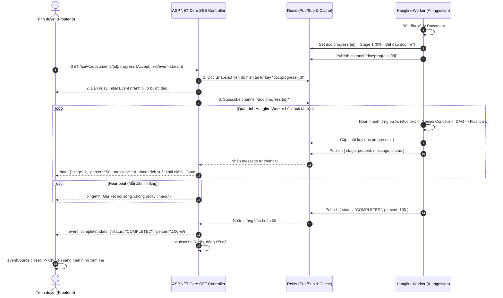

# BÁO CÁO THIẾT KẾ KỸ THUẬT (BRAINSTORM & TECHNICAL DESIGN REPORT)
## UC-03.2: Theo Dõi Tiến Độ Nền Thời Gian Thực (Server-Sent Events - SSE)

- **Phân hệ**: Backend AI Pipeline & Xử lý Tài liệu (Thành viên 2)
- **Use Case liên quan**: UC-03.1 (Upload & Queue), UC-03.2 (SSE Progress), S-06 (Modal Upload)
- **Thời gian lập**: 2026-11-08
- **Tiêu chí cốt lõi**: **Đơn giản nhất, khả thi nhất, dễ test nhất, không phụ thuộc thư viện phức tạp**

---

## 1. Problem-First Inversion (Phân tích Chiều sâu Vấn đề)

### 1.1. Nỗi đau thực tế của Người Dùng & Developer
- **Phía Người dùng**: Quá trình bóc tách AI qua Gemini kéo dài từ 30 giây đến 2 phút. Nếu chỉ có một biểu tượng loading xoay tròn vô định, học viên sẽ sốt ruột, bấm F5 tải lại trang hoặc tắt tab, dẫn đến việc gián đoạn trải nghiệm hoặc gửi lại request gây tốn token.
- **Phía Frontend Developer**: Không muốn phải cài đặt các SDK nặng nề (như SignalR client), không muốn đau đầu xử lý handshake WebSocket qua CORS/Proxy.
- **Phía Backend Developer**: Cần một giải pháp truyền tin từ background worker (Hangfire) sang HTTP request của client mà không làm nghẽn thread pool của server.

### 1.2. Đánh giá "Phương án Dễ Nhất & Khả Thi Nhất"
Theo yêu cầu *"không cần bám sát câu chữ SRS, chọn phương án dễ nhất, khả thi nhất"*:

| Tiêu chí | Phương án A (Được chọn): Native ASP.NET Core SSE + Redis Pub/Sub | Phương án B: SignalR Hub | Phương án C: Short Polling (`GET /progress` mỗi 2s) |
| :--- | :--- | :--- | :--- |
| **Frontend Setup** | **Cực dễ: Dùng sẵn `new EventSource()` của trình duyệt (Zero dependencies)** | Phải `npm install @microsoft/signalr`, dựng connection builder | Dễ nhưng tạo tải ảo |
| **Backend Code** | **Một Action C# duy nhất dùng `IAsyncEnumerable` hoặc `Response.Body`** | Phải cấu hình Hub, mapping route, DI `IHubContext` | Đơn giản nhưng đơ DB |
| **Tương thích Proxy/CORS** | Rất cao (HTTP GET tiêu chuẩn) | Phức tạp (CORS với Credentials, WebSockets handshake) | Rất cao |
| **Độ trễ** | Thời gian thực (Mili-giây) | Thời gian thực (Mili-giây) | Trễ 2–3 giây |
| **Multi-tab / User B** | Hỗ trợ tự nhiên qua Redis Pub/Sub channel | Hỗ trợ qua SignalR Group | Hỗ trợ qua DB query |
| **Kết luận** | **CHỌN PHƯƠNG ÁN A**: Vừa đơn giản nhất cho Frontend, vừa hoàn toàn khả thi và nhẹ nhàng trên ASP.NET Core .NET 8. | Quá nặng cho bài toán chỉ đẩy tiến độ 1 chiều | Không tối ưu hiệu năng |

---

## 2. Thiết Kế Kỹ Thuật Chi Tiết (Technical Architecture)

### 2.1. Sơ đồ Luồng Truyền Tin Thời Gian Thực (Data Flow)



---

### 2.2. Định Nghĩa 4 Mốc Tiến Độ Chuẩn Hóa (Progress Stages)

Tiến trình được chia thành 4 giai đoạn logic rõ ràng, mỗi giai đoạn chiếm 25%:

| Giai đoạn | Tên Giai Đoạn | Phần Trăm (%) | Thông Điệp Hiển Thị Cho Người Dùng | Tác Vụ Backend Tương Ứng |
| :---: | :--- | :---: | :--- | :--- |
| **Stage 1** | Khởi tạo & Trích xuất Văn bản | **0% $\to$ 25%** | *"Đang đọc cấu trúc tài liệu và bóc tách các trang slide..."* | Đọc text PDF/PPTX qua `PdfSharpCore` / `ZipArchive`, chia chunk ngữ nghĩa. |
| **Stage 2** | AI Trích xuất Khái niệm | **25% $\to$ 50%** | *"Gemini AI đang phân tích nội dung và trích xuất các khái niệm cốt lõi..."* | Gọi Gemini API với Semantic Chunks, sinh danh sách `ConceptNodes`. |
| **Stage 3** | Xây dựng Đồ thị Tiên quyết | **50% $\to$ 75%** | *"Đang liên kết đồ thị tri thức và kiểm tra chu trình DAG..."* | Chạy thuật toán Tarjan phát hiện/khử chu trình, tạo quan hệ `PREREQUISITE_OF`. |
| **Stage 4** | Sinh Flashcards & Câu hỏi | **75% $\to$ 100%** | *"Đang tạo flashcards kèm trích dẫn số trang và hoàn tất bộ thẻ..."* | Sinh thẻ bài kèm số trang gốc `source_page`, lưu `raw_ai_payload JSONB` và DB. |

---

### 2.3. Hợp Đồng Dữ Liệu Sự Kiện (SSE Event Payload Contract)

Mỗi sự kiện bắn xuống Client có định dạng JSON chuẩn:

```json
{
  "document_id": "9b1deb4d-3b7d-4bad-9bdd-2b0d7b3dcb6d",
  "stage": 2,
  "stage_name": "Trích xuất Khái niệm",
  "percent": 50,
  "message": "Gemini AI đang phân tích nội dung và trích xuất các khái niệm cốt lõi...",
  "status": "PROCESSING",
  "timestamp": "2026-11-08T08:20:00Z"
}
```

**Các Loại Sự Kiện (Event Types)**:
1. `event: progress` (Mặc định): Cập nhật tiến độ bình thường.
2. `event: complete`: Bắn khi đạt 100%, payload chứa thêm `concepts_count`, `flashcards_count`, `deck_id`. Báo hiệu client gọi `eventSource.close()`.
3. `event: error`: Bắn khi tác vụ thất bại, payload chứa `error_message`. Client đóng stream và hiển thị nút "Thử lại".
4. `: ping`: Heartbeat comment định kỳ 15 giây, client tự động bỏ qua, có tác dụng chống proxy ngắt kết nối.

---

### 2.4. Mã Nguồn Mẫu Backend C# (.NET 8) Cực Kỳ Gọn Nhẹ

#### A. Endpoint SSE Controller
```csharp
[ApiController]
[Route("api/v1/documents")]
public class DocumentProgressController : ControllerBase
{
    private readonly IConnectionMultiplexer _redis;
    private readonly AppDbContext _dbContext;

    public DocumentProgressController(IConnectionMultiplexer redis, AppDbContext dbContext)
    {
        _redis = redis;
        _dbContext = dbContext;
    }

    [HttpGet("{id:guid}/progress")]
    public async Task GetProgress(Guid id, CancellationToken cancellationToken)
    {
        Response.Headers.Append("Content-Type", "text/event-stream");
        Response.Headers.Append("Cache-Control", "no-cache");
        Response.Headers.Append("Connection", "keep-alive");
        Response.Headers.Append("X-Accel-Buffering", "no"); // Quan trọng: Tắt buffer của Nginx

        var db = _redis.GetDatabase();
        var sub = _redis.GetSubscriber();
        var channel = RedisChannel.Literal($"doc:progress:{id}");

        // 1. Gửi ngay Initial Snapshot để tránh bị lỡ bước
        var cachedJson = await db.StringGetAsync($"doc:progress:{id}");
        if (!cachedJson.IsNullOrEmpty)
        {
            await Response.WriteAsync($"data: {cachedJson}\n\n", cancellationToken);
            await Response.Body.FlushAsync(cancellationToken);

            // Nếu đã hoàn thành từ trước, đóng ngay
            if (cachedJson.ToString().Contains("\"status\":\"COMPLETED\""))
            {
                await Response.WriteAsync("event: complete\ndata: {}\n\n", cancellationToken);
                await Response.Body.FlushAsync(cancellationToken);
                return;
            }
        }

        // 2. Dùng Channel để cầu nối giữa Redis Event và HTTP Response Stream
        var messageChannel = System.Threading.Channels.Channel.CreateUnbounded<string>();

        await sub.SubscribeAsync(channel, (ch, msg) =>
        {
            messageChannel.Writer.TryWrite(msg.ToString());
        });

        try
        {
            using var timeoutCts = new CancellationTokenSource();
            using var linkedCts = CancellationTokenSource.CreateLinkedTokenSource(cancellationToken, timeoutCts.Token);

            while (!cancellationToken.IsCancellationRequested)
            {
                // Chờ tin nhắn từ Redis hoặc bắn Ping sau 15 giây
                var readTask = messageChannel.Reader.WaitToReadAsync(linkedCts.Token).AsTask();
                var delayTask = Task.Delay(15000, linkedCts.Token);

                var completedTask = await Task.WhenAny(readTask, delayTask);

                if (completedTask == delayTask)
                {
                    // Bắn Heartbeat giữ kết nối sống
                    await Response.WriteAsync(": ping\n\n", cancellationToken);
                    await Response.Body.FlushAsync(cancellationToken);
                    continue;
                }

                while (messageChannel.Reader.TryRead(out var message))
                {
                    if (message.Contains("\"status\":\"COMPLETED\""))
                    {
                        await Response.WriteAsync($"event: complete\ndata: {message}\n\n", cancellationToken);
                        await Response.Body.FlushAsync(cancellationToken);
                        return;
                    }
                    if (message.Contains("\"status\":\"FAILED\""))
                    {
                        await Response.WriteAsync($"event: error\ndata: {message}\n\n", cancellationToken);
                        await Response.Body.FlushAsync(cancellationToken);
                        return;
                    }

                    await Response.WriteAsync($"data: {message}\n\n", cancellationToken);
                    await Response.Body.FlushAsync(cancellationToken);
                }
            }
        }
        finally
        {
            await sub.UnsubscribeAsync(channel);
        }
    }
}
```

#### B. Cách Hangfire Worker Cập Nhật Tiến Độ
Trong Hangfire Worker, mỗi khi hoàn thành một công đoạn, chỉ cần gọi một hàm helper cực kỳ đơn giản:

```csharp
public async Task PublishProgressAsync(Guid documentId, int stage, string stageName, int percent, string message, string status = "PROCESSING")
{
    var payload = new
    {
        document_id = documentId,
        stage = stage,
        stage_name = stageName,
        percent = percent,
        message = message,
        status = status,
        timestamp = DateTimeOffset.UtcNow
    };

    var json = JsonSerializer.Serialize(payload);

    var db = _redis.GetDatabase();
    var sub = _redis.GetSubscriber();

    // 1. Lưu snapshot vào Redis cache (hạn sống 1 giờ)
    await db.StringSetAsync($"doc:progress:{documentId}", json, TimeSpan.FromHours(1));

    // 2. Bắn sự kiện ra channel cho tất cả người nghe (User A, User B, nhiều tab)
    await sub.PublishAsync(RedisChannel.Literal($"doc:progress:{documentId}"), json);
}
```

---

### 2.5. Phía Frontend: Tối Giản Đến Mức Tuyệt Đối (Zero Library)

Frontend (React / Vue / HTML) chỉ cần sử dụng native `EventSource` có sẵn trong mọi trình duyệt:

```javascript
function trackDocumentProgress(documentId, onProgress, onComplete, onError) {
  const eventSource = new EventSource(`/api/v1/documents/${documentId}/progress`);

  // Lắng nghe tiến độ bình thường
  eventSource.onmessage = (event) => {
    const data = JSON.parse(event.data);
    onProgress(data.percent, data.message, data.stage_name);
  };

  // Lắng nghe khi hoàn thành 100%
  eventSource.addEventListener('complete', (event) => {
    eventSource.close(); // Đóng kết nối ngay, chống tự động reconnect
    onComplete();
  });

  // Lắng nghe khi có lỗi
  eventSource.addEventListener('error', (event) => {
    eventSource.close();
    onError("Quá trình xử lý tài liệu thất bại.");
  });
}
```

---

## 3. Khả Năng Mở Rộng & Hỗ Trợ Đa Người Dùng (Multi-subscribers)

- **Hỗ trợ User B (WaitingOriginal từ UC-03.1)**:
  - Khi User B upload trùng file đang `PROCESSING`, UC-03.1 trả về cùng `document_id` gốc và URL SSE này.
  - Cả User A và User B cùng gọi `GET /api/v1/documents/{id}/progress`.
  - Nhờ cơ chế **Redis Pub/Sub**, hàng chục người dùng hoặc nhiều tab của cùng một tài liệu đều nhận được cùng một dòng sự kiện chính xác đến từng mili-giây mà không tốn thêm tài nguyên tính toán nào của AI!

